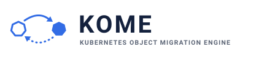
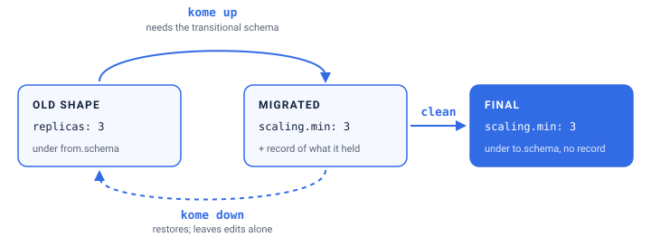

<div align="center">
  

  <p><strong>Alembic for Kubernetes objects.</strong></p>

  <p>
    <a href="https://github.com/intentd/kome/actions/workflows/ci.yml"></a>
    <a href="https://github.com/intentd/kome/tags"></a>
    <a href="https://pkg.go.dev/github.com/intentd/kome"></a>
    
    
  </p>
</div>

KOME (pronounced "come") moves stored Kubernetes objects from one schema to another with `kome up`, takes them back with `kome down`, and makes the move final with `kome clean`.

```console
kome validate     # check the file offline
kome rehearse     # run every migration end to end in a throwaway cluster
kome up           # migrate
kome down         # undo, leaving anything edited since alone
kome clean        # make it final
```

## Install

```console
curl -sSL https://raw.githubusercontent.com/intentd/kome/main/install.sh | bash
```

The script installs the latest release into `~/.kome/bin` and adds it to your `PATH`. It checks every archive against the release's `checksums.txt`, and that file's cosign signature when cosign is installed. `KOME_VERSION` pins a release and `KOME_INSTALL_DIR` changes the directory.

With Homebrew:

```console
brew install intentd/tap/kome
```

From source, with Go: `make build` (see [Building](#building)).

## Why

Custom resources outlive their schemas. A field gets a better name, a flat value becomes a structure, a kind is renamed, a namespaced resource becomes cluster-scoped. Each change leaves every stored object in the old shape, and teams write one-off scripts to move them: run once, never rehearsed, no way back.

Databases solved this long ago. Alembic and its kin give schema changes a file, an `upgrade` and a `downgrade`. KOME does the same for Kubernetes objects, with two differences that Kubernetes asks for:

- **The record lives on the object.** There is no history table. Every migrated object carries an annotation with what it held before, so undo is a data operation on the objects themselves.
- **Other writers keep writing.** Controllers and people change objects while a migration is in place. KOME never overwrites a change it did not make: a value edited after the migration is reported as drifted and left alone.

<p align="center">
  
</p>

## What it moves

| Level | What moves | Example |
| --- | --- | --- |
| **Field** | Values to new paths, as a kind's schema changes | `spec.replicas` → `spec.scaling.min`; a cron string → five structured fields |
| **Kind** | Every selected object to another kind, group or scope | `AppConfig` → `NewConfig`; namespaced → cluster-scoped |

A migration does one or the other, never both: do one, then the next.

### What KOME is not

| Need | Use instead |
| --- | --- |
| Rewriting objects between versions of **the same** CRD | A conversion webhook, then the API server's storage version migration |
| Applying CRDs in a live cluster | Your deployment tooling. KOME reads schemas, and applies them only inside `kome rehearse`'s cluster |
| A history of applied migrations | Nothing. KOME keeps no store; the record lives on each object |
| Reconciling the new objects | Your controller |

A conversion webhook keeps one object readable at several versions of one CRD. KOME moves objects *between* shapes that no single CRD version serves, and needs no running server.

## A migration file

`kome.yaml` declares the migrations. It is not a Kubernetes object; its one key is `migrations`.

```yaml
migrations:

  # Field level: the kind stays; its schema changes and values move.
  cronjob:
    from:
      schema: ./schemas/cronjob-old.yaml
      objects: [./objects/cronjobs.yaml]
    to:
      schema: ./schemas/cronjob.yaml
    spec:
      replicas:                          # the stored path
        to: scaling.min
      timeout:
        from: timeoutSeconds
        to: timeout
        value: '{{ printf "%ds" .value }}'
      schedule:                          # fanout: one value, several paths
        values:
          schedule.minute: '{{ cronMinute .value }}'         # a template: text
          schedule.daily:  '${ value.endsWith("* * *") }'    # CEL: a boolean

  # Kind level: objects move to another kind.
  appconfig:
    from:
      schema: ./schemas/appconfig.yaml
      objects: [./objects/appconfigs.yaml]
    to:
      schema: ./schemas/newconfig.yaml
      copyStatus: true
    selection:
      namespaces: [default, staging]
      selector: tier=web
    lifecycle:
      prune: true                       # delete each source once its destination holds every field
      children: reparent                # what it owns: reparent | orphan | delete
      finalizers: [example.io/cleanup]  # the only finalizers KOME may remove first
```

A migration with `spec` moves is field level and needs the same kind on both sides. One without is kind level and needs a different kind, group or scope. Schemas are CRD manifest files. `objects` are optionl files of objects in that shape: `validate` checks them, and `rehearse` seeds them.

Values support Go templates (`{{ … }}`) and CEL (`${ … }`), both with the [KEL](https://github.com/intentd/kel) functions. A template writes text; CEL keeps the type (`'${ value * 2 }'` writes a number). Anything else is written as is.

### Order: `needs`

A migration can name the ones that must be done first, as in GitHub Actions:

```yaml
  v3-timeout:
    needs: [v2-scaling]
```

Migrations run in that order (name order where `needs` leaves a choice), and `validate` rejects a cycle or an unknown name. `up` refuses while a migration it needs, and is not part of the run, is still pending; `down` undoes the latest first and refuses while one that needs it is still applied. Where the cluster stands is read from the objects, not from a history table: `kome status` shows each migration's pending, migrated and drifted objects. Field records are keyed by migration, so two migrations moving the same value (a → b, then b → c) are undone one step at a time, and the transitional schema of a migration covers the field migrations of the same kind it needs.

### Field managers and other writers

KOME's writes carry the field manager `kome`, or the migration's `fieldManager:` when the file declares one (an operator's, so the changes are attributed to it). Under a declared manager KOME creates and patches but never server-side applies: applying as an operator would make that operator's next apply remove what KOME wrote. The record keeps the manager, so `down` undoes the move as the one that made it. `--field-manager` overrides both.

Each run reports who else writes what it moves, from the objects' `managedFields`: a GitOps tool or Helm release still writing the old shape will put it back, so it has to change too.

### Pruning

Deleting a source would also delete everything it owns (garbage collection follows `ownerReferences`), and a finalizer can hold the delete forever. So a prune is planned before anything is written, and refused unless the file says what to do:

- **Children.** A source that owns objects is pruned only with `lifecycle.children`: `reparent` points them at the destination first (a namespaced destination can own only objects in its own namespace), `orphan` keeps them without that owner, `delete` lets them go with the source.
- **Finalizers.** KOME removes only those listed in `lifecycle.finalizers`, then deletes. A source with any other finalizer is not pruned. A finalizer usually means the old controller cleans something up on delete; the destination now owns that something, so the cleanup must not run. Kubernetes' own finalizers can't be listed.

`up --dry-run` names the children and finalizers that stand in the way, and the lines to add. `down` recreates the source, puts the removed finalizers back, points the reparented children at it, and only then deletes the destination: a child left pointing at a deleted owner would be garbage-collected.

## Principles

1. **The record lives on the object.** No database, history table or lock store.
2. **Never overwrite what you did not write.** Drift is decided by comparing values with what the migration wrote, not by `resourceVersion`, which changes on every status update.
3. **Nothing is lost on a refusal.** A drifted field keeps its record, a drifted destination keeps its source, and a source is pruned only when its destination holds every source field.
4. **Safe by default.** KOME generates the transitional schema people don't know they need, refuses to write a path the live schema would drop, and asks before pruning.
5. **Narrow, never widen.** The file scopes a migration. Flags can narrow that scope but never widen it.
6. **Honest results.** Each object ends in exactly one stated outcome: migrated, skipped, excluded, drifted, pruned, kept, too-large or failed. Every command has JSON output.
7. **The CLI is the version.** The file carries no version; the KOME release you run defines what it means.

## Commands

| Command | Does |
| --- | --- |
| `kome validate` | Checks the file offline: identities and level, both schemas, field coverage, the transitional schema, the objects. Reports every problem at once. |
| `kome transitional` | Writes each field migration's transitional schema (below). `-o <dir>` writes the files there. |
| `kome up` | Checks the live schema, then migrates the selected objects. Asks before pruning; `--yes` skips the question. |
| `kome down` | Restores migrated objects from their records, leaving drift alone. |
| `kome clean` | Removes the records. The migration becomes final. |
| `kome status` | Shows, per migration, how many objects are pending, migrated and drifted, and what it needs. |
| `kome rehearse` | Runs every migration from start to end in a throwaway cluster. |
| `kome version` | Prints the version. |

`up`, `down` and `clean` take `--dry-run`, `--strict`, `-o json`, and scope flags that narrow a migration's own selection: `-k/--kind`, `-n/--namespace`, `--name`, `--selector`. `up` also takes `--set key=value` to change a migration for one run.

## The transitional schema

Kubernetes drops fields a schema doesn't declare. While objects move from old paths to new ones, the stored schema must declare both. That is the transitional schema. KOME generates it from `to.schema`: it adds every `from` path `to.schema` lacks and makes the new paths optional, and a path whose type changes in place may hold either shape. `kome up` refuses to start until the live schema declares every path it writes.

```console
kome transitional -o ./schemas          # write it
kubectl apply -f ./schemas/cronjob-transitional.yaml
kome up
kubectl apply -f ./schemas/cronjob.yaml # the final schema
kome clean                              # once you no longer need down
```

To review or extend the transitional schema yourself, declare `transitional.schema`; KOME checks it instead of generating one.

## Rehearsal

A migration runs once in production, so KOME runs it first where nothing is at stake: the same file, the same objects, a throwaway cluster.

```console
kome rehearse                     # creates a kind cluster, deletes it after
kome rehearse --context kind-dev  # or use an existing cluster
```

For each migration, the rehearsal:
1. Applies the schemas and seeds the objects.
2. Checks that `up` refuses without the transitional schema.
3. Runs a dry run, then `up`.
4. Edits one migrated value and checks that `down` leaves it alone while restoring the rest.
5. Migrates again, applies the final schema, and runs `clean`.

At kind level it also prunes, then restores the pruned sources.

What an object would meet for real, such as two sources colliding on one cluster-scoped name, is a **known issue**. It is listed, the object is set aside, and the rehearsal goes on. A step fails only when KOME itself misbehaves.

```console
appconfig 2. up --dry-run: ok (3 would migrate, 0 not selected) ⚠ 1 known issue
...
known issues (1): the migration meets these when it runs for real
  ⚠ appconfig step 2: team-c/payments: destination payments is also the target of team-a/payments in this run
```

## The record

Each migrated object carries annotations under KOME's prefix (`kome.intentd.io`). `down` and `clean` find records by that prefix, so it is permanent.

| Annotation | On | Holds |
| --- | --- | --- |
| `migrate-field-snapshot` | The migrated object | Each field migration's moves, by migration: the values before and after, and the field manager |
| `migrate-kind-snapshot` | The destination | The source's identity, metadata, spec and status; whether it was pruned; whether the destination existed before; the children it reparented and the finalizers it removed |
| `migrate-timestamp` | Both | When the last migration ran |

A record is JSON, readable with `kubectl get -o yaml`. Kubernetes caps an object's annotations at 256 KiB, keys and values together, so a record that would not fit as JSON is written gzip-compressed, in base64. An object without room for its record even then is not migrated: KOME never migrates what it can't take back. `up` reports it as `too-large`, a dry run included, and `kome rehearse` lists it as a known issue.

## As a library

```go
f, _ := declaration.Load("kome.yaml")
if err := f.Validate().Err(); err != nil { … }
ms, _ := kome.FromFile(f)

kube, err := kome.KubeForConfig(cfg, nil) // or a controller's mgr.GetRESTMapper()
results, err := (&kome.Engine{Kube: kube}).Up(ctx, ms, kome.Options{DryRun: true})
```

`KubeForConfig` builds client-go's dynamic and discovery clients from the `rest.Config`. A nil mapper gets one that rediscovers kinds it doesn't know, so a CRD installed during a run is found; a controller passes its own.

`Engine` takes the annotation prefix, the field manager and the template functions as parameters, and a `Transformer` for callers that already apply the same transforms elsewhere. That is how [Inrun](https://inrun.dev) runs its migrations through KOME: it uses its own prefix (`inrun.dev`) and the functions its gateway uses, so live writes and the backfill always agree. The engine does not log; what it met is in its results.

| Package | Holds |
| --- | --- |
| `declaration` | The file: parsing, `--set`, offline validation |
| `engine` | Run settings, selection, results, guarded writes |
| `field`, `kind` | Field-level and kind-level up, down and clean |
| `transitional` | Generating the transitional schema |
| `rehearse` | The rehearsal sequences |
| `report` | JSON and text reports |
| `cli` | The CLI: `cli.Command()` is the root command |
| `cmd/kome` | Runs it |

## Building

```console
make build   # → ~/.kome/bin/kome, stamped with the git version
make test
```

KOME builds on [tools](https://github.com/intentd/tools) and [KEL](https://github.com/intentd/kel).
